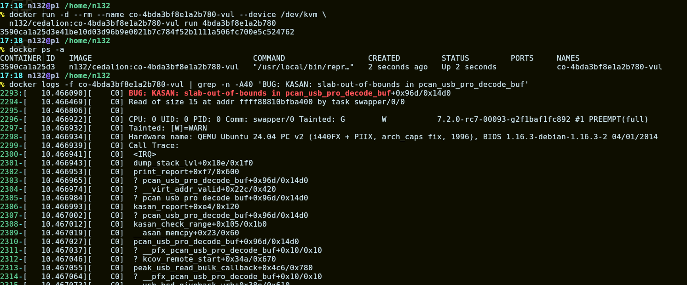

# Cedalion (bugs.sh)

We have discovered a more efficient approach to finding vulnerabilities in the
Linux kernel. Because the manpower to review LLM-generated patches is limited,
we make low-severity bugs public and ask for the community's help patching them,
similar to syzbot.

bugs.sh presents each disclosed issue with a reproduction environment and a PoC
that triggers the reported vulnerability. This repository contains the public
data and the [reproduction script](reproduction/repro.sh).

If you are interested in helping the Linux kernel address these security issues,
visit https://bugs.sh. You can also reach
us at co@bugs.sh.

## Reproduce a bug

```bash
# Build the image
reproduction/repro.sh build 4bda3bf8e1a2b780
# Run it
reproduction/repro.sh run 4bda3bf8e1a2b780
```

## Dataset (in-progress)

> Only public/patched (no race) bugs are currently included.

We are building an interactive reproduction dataset.

After an image has been pushed, another machine can reproduce the bug with one
Docker command:

```bash
docker run -it --rm --device /dev/kvm n132/cedalion:CVE-2026-99298 co vul
```

Expected output:



## More

Detailed reproduction notes are in [`reproduction/README.md`](reproduction/README.md).

## Local feature preview

```bash
python3 build.py
CEDALION_LIVE=1 HOST=0.0.0.0 PORT=65432 python3 tools/preview.py
```

Open `http://localhost:65432/`, or use this machine's hostname/IP from another
machine. Live mode reads pages from `web/` and the current `bugs.json` on each
request; disclosed artifact downloads use the built `docs/` directory.

The **Contributors** page groups names credited with `Signed-off-by`,
`Reviewed-by`, `Tested-by`, `Acked-by`, `Suggested-by`, `Co-developed-by`, and
`Reported-by` on fixing commits for bugs with an assigned CVE. Combined
`Reported-and-tested-by` credits count as reporting and testing. Multiple tags
on one CVE count only once per person; roles remain visible. Address-only bot
reports, tool credits (`Assisted-by`), and metadata (`Cc`, `Fixes`, `Link`) are
excluded. `extract.py` refreshes these credits from
`CEDALION_STABLE_REPO` whenever it updates the register. If a fixing commit is
missing, it uses the mainline `.sha1` entry in `CEDALION_CVE_DIR` when available.
No separate contributor list needs maintenance. The page loads the published
static data once when opened or reloaded, with no background polling. Production
updates through the normal extract/build/push workflow.
